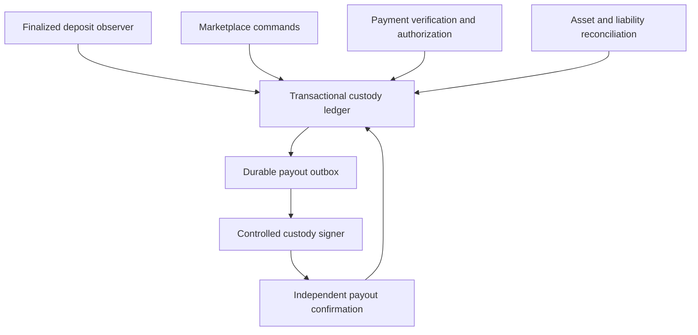

# Alpha Wallet — development foundation

Date: 4 November 2026. Scope: architecture and **offline development only**.
Base: `0b11b21fc0de3d04e4325a748ea2de62ade4f317` (the existing marketplace main branch when this work began).
Working branch: `feature/alpha-wallet-dev-20261104`.

This is an executable specification and a separately tested SQL storage draft. It is not a live wallet, a testnet deployment, a custody provider, or a production-ready financial service. There are no real deposit addresses, keys, signing functions, RPC requests, public routes, scheduled workers, or applied migrations in this change.

## What the agreed experience means

1. A seller funds the USDT principal they want to sell. A 500 USDT listing requires the full 500, with no short-payment tolerance.
2. A valid finalized deposit credits that seller's account once. The listing becomes eligible to display automatically when fully funded and approved under the existing owner-review policy.
3. Each accepted purchase moves its precise principal from listing inventory to a trade reservation. The same units cannot back another trade or withdrawal.
4. A buyer saying they paid creates a payment claim. An independent trusted verification step and the seller's release authorization must both exist before the automated payout process starts.
5. The outgoing transfer is represented by one immutable intent. A timeout leaves the outcome uncertain and funds reserved. Completion requires a matching finalized successful transfer receipt.
6. The buyer receives the full agreed USDT principal. Current 1% buyer + 1% seller fees remain separate, and the trade records their exact amounts once.

“Automatic” applies to deterministic work after its evidence and policy conditions are satisfied. The blockchain does not itself prove that cash changed hands or a bank transfer reached the seller. Cash, face-to-face, and bank payment verification need a concrete authority model before production integration.

## Implemented in this milestone

| Component | Implemented behavior | Current boundary |
| --- | --- | --- |
| Exact amounts | Decimal-string inputs; integer raw units; bounds; per-asset precision; six-decimal marketplace fee rounding | Synthetic assets only |
| Deposits | Dedicated synthetic intent; chain/token/destination/amount validation; pending/finalized distinction; event deduplication | Evidence is supplied by a trusted test fixture, not a live observer |
| Listings | Full principal funding; separate owner approval; automatic allocation after credit; partial inventory | Existing marketplace remains disconnected |
| Trades | Partial reservations; three active trades per seller; self-trade rejection; cancellation before payment claim | Synchronous single-process specification |
| Payment/release | Exact inclusive fiat evidence; evidence reuse blocked; independent fixture verifier; seller authorization bound to principal and recipient | Real authentication, bank/cash evidence adapters, and policy review are still required |
| Payouts | Immutable intent; one dispatch claim; unknown/broadcast/failed/finalized outcomes; matching receipt; retained uncertain funds | No signer or real network submission |
| Withdrawals | Only unallocated seller funds; same-asset recipient; synthetic step-up marker; immutable intent | Marker is not a real MFA implementation |
| Fees | Full principal delivered; separate commission account; one post-completion due; auto-settlement when funded; unpaid dues block new seller commitments | Principal and commission tolerance are never mixed |
| Incident behavior | Dispute stops queued dispatch; account mismatch or changed finalized deposit evidence pauses new outgoing work | Resume, adjudication, and payout replacement require later controlled recovery commands |
| Accounting | Balanced journal; no negative custody allocations; conservation checks after every command; atomic rollback on rejected commands | In-memory ledger is not durable storage |
| SQL draft | Exact numeric constraints; immutable journals; event uniqueness; reserve/outbox constraints; access restrictions | Separate PGlite proof, not connected to the simulator or production |

## Financial policy preserved

The current shared contracts state that the buyer receives the full USDT quantity, pays a 1% fee within the fiat total to the seller, and the seller remits the combined 2% in USDT after completion. The wallet must not turn a 500 USDT sale into a 490 USDT delivery.

| Full 500 USDT sale | Amount |
| --- | ---: |
| Principal deposited for listing | 500 USDT |
| Principal delivered across buyers | 500 USDT |
| Buyer fee collected by seller in fiat | Equivalent of 5 USDT |
| Seller's own fee | 5 USDT |
| Combined post-completion commission | 10 USDT |

The demo adds 10 USDT to a separate commission account to demonstrate automatic settlement. That is a separate optional fee-funding fixture, **not a silent change requiring a 510 USDT principal deposit**. If no commission funds exist when a payout completes, the model records the due and blocks new commitments while allowing already accepted trades to finish. A later commission deposit automatically settles eligible dues. Production automatic fee funding, network-fee funding, legacy commission carry-forward integration, and fee-account withdrawals need explicit final implementation choices.

Existing rules referenced:

- `packages/contracts/src/marketplace-fees.ts`: versioned buyer/seller terms and inclusive fiat rounding.
- `packages/contracts/src/commission-amount.ts`: each 1% rounded half-up to six decimals, then summed.
- `src/lib/commission-shortfall-ledger.ts`: current commission-only shortfall behavior. Its tolerance must never apply to escrow principal.

## Architecture for the later integrated system



The ledger is the financial source of truth. Marketplace cards and trade statuses are projections of its committed state. All balance changes, reservation state changes, command idempotency records, and outbox events must commit in one database transaction. Do not call a marketplace write and a wallet write in separate transactions and assume they are atomic.

The signer must run behind a separate controlled boundary. It receives only an immutable, authorized transfer intent and must apply its own allowed asset, destination, amount, operational limits, and pause checks. It must not accept arbitrary client-supplied transaction bytes. Secrets never belong in the browser, source repository, public environment variables, logs, or this chat.

The provider is intentionally undecided. An Alpha-controlled signing system and a custody-provider integration have different operational requirements. This foundation does not create a wallet under either model or claim a provider has been selected.

### Ledger and conservation rules

The executable model uses distinct allocation accounts: seller available principal, listing principal, trade reservation, payout reservation, seller commission funds, and platform commission revenue. An external contra-account balances deposits and confirmed withdrawals. These are a balanced internal custody subledger, not a complete corporate general ledger.

For each asset, the sum of internal allocations equals expected on-chain custody. Customer principal and platform revenue are separately identifiable. No asset can make another network solvent. A reservation transfers ownership of existing allocated units; it never creates additional USDT. Every journal transaction is balanced, and every command either commits all of its effects or none.

The SQL draft uses integer-checked unrestricted `NUMERIC` domains with a uint256 upper bound. A scaled `NUMERIC(78,0)` alone can round fractional input before a check, so explicit integrality checks are used. Account locks, required `SERIALIZABLE` writes, and deferred journal constraints are proposed storage protections. The future adapter must retry complete serialization failures; a row lock alone does not refresh a `REPEATABLE READ` snapshot. Constraint checks run on entry insertions as well as journal creation so an early `SET CONSTRAINTS` cannot leave later entries unchecked. PGlite validation does not prove real PostgreSQL multi-process race safety or worker recovery.

### Chain identity and finality

The two simulation assets intentionally have different identities and precision:

| Simulation asset | Network | Precision | Real asset intended for later separate review |
| --- | --- | ---: | --- |
| `tron-sim-usdt` | `tron-simulation` | 6 | TRON USDT |
| `bsc-sim-binance-peg-usdt` | `bsc-simulation` | 18 | Binance-Peg USDT on BNB Smart Chain |

The existing manual marketplace permits some differing listing/receiving networks. The wallet prototype deliberately requires the funded asset and payout asset to match. A bridge or cross-chain liquidity service is not implied.

Future observers must validate environment, chain, exact allowlisted contract, transfer-event index, transaction identity, recipient, raw units, canonical block identity, successful execution, and finality. The event identity is `(network, token, transaction, event index)`, rather than amount, token symbol, or transaction hash alone. Indexers discover candidates; authoritative receipt checks determine creditability. Preserve completed scan coverage and checkpoints so outages cannot falsely become “no deposits.”

TRON's documentation distinguishes broadcast success, indexing, transaction inclusion, solidification, and execution success; the last two are both needed for a valid token deposit. BSC exposes finalized state through its JSON-RPC API. These are separate chain adapters, not one arbitrary elapsed-time delay. See the primary references below.

### Outgoing transfer rules

The simulator advances an intent through `queued → submitting → submission_unknown/broadcast → confirmed/failed_final`. `failed_final` deliberately retains its reserved funds until a future reviewed recovery command establishes the safe next action. A provider timeout is not a failed payment, and a single empty lookup does not justify replacement.

Before dispatch, require fresh matching reconciliation, separately funded native network fees, an undisputed trade, complete authorization, and an unconsumed dispatch claim. Replaying the same dispatch request returns `shouldDispatch: false` with the current intent. A new request cannot create a second dispatch for the same payout. Actual worker recovery will additionally need durable provider-side idempotency and lookup by the original transfer identity; process memory is insufficient.

Disputes opened before dispatch stop the outgoing action. A dispute opened after a transaction has been submitted cannot undo a blockchain broadcast: the reservation remains, and independently observed settlement must still be accounted for. No owner override may bypass the asset, balance, authorization, or duplicate-transfer invariants.

## Existing platform integration findings

| Existing boundary | Required later change |
| --- | --- |
| `createMarketplaceListing` and owner review in `alpha-exchange-store.ts` | Add funded-principal eligibility while retaining owner approval |
| `createPurchaseRequest` / accepted trade transitions | Bind chain/token/recipient and reserve principal atomically |
| `updateTradeTerms` | Resize reservations atomically within current pre-payment adjustment rules; invalidate changed authorizations |
| Current `funds_received` | Do not use as wallet authority; face-to-face presently allows a buyer-originated transition |
| Current `usdt_sent` / owner completion | Do not infer a blockchain transfer from a manual status change |
| Cancellations and disputes | Preserve reservation until safely cancellable; freeze unsent intents; distinguish in-flight outcomes |
| Completion and receipts | Derive financial completion from payout confirmation; apply benefits/history/fees once |
| `alpha-exchange-repository.ts` | Use dedicated transactional wallet commands; avoid generic snapshot replacement for ledger state |
| Mobile auth route matching | Explicitly apply phone, age, session, and role checks to wallet routes; current route regex alone does not include them |

No production integration in this table has been performed in this milestone.

## Verification and local execution

From the repository root, using its existing pinned dependencies:

```bash
node node_modules/vitest/vitest.mjs run src/lib/alpha-wallet
NODE_ENV=development node --import tsx scripts/alpha-wallet/demo.ts
```

The test runner sets a test environment. The demo explicitly opts into local development. The factory rejects production and recognized hosted runtimes, refuses mainnet/signing flags, and rechecks those conditions for mutations. The SQL draft also requires an explicit simulation-only setting before it can create its isolated schema. These are development guards, not substitutes for production security design.

The demo simulates a pending deposit, final 500 USDT funding, 200 and 300 USDT purchases, verified payment, uncertain payout response, safe duplicate handling, and separate 10 USDT commissions. It asserts that the full 500 reaches buyers and the remaining 10 is platform revenue. Its native-fee readiness is a synthetic policy fixture, not a real gas purchase or cost model.

The test report records the actual checks run and their limits. Do not describe a local green suite as an independent security audit, real blockchain test, or guarantee of bug-free operation.

## Next development milestones and exit criteria

| Milestone | Concrete work | Evidence needed before advancing |
| --- | --- | --- |
| 1. Offline foundation | This architecture, domain engine, SQL draft, adversarial tests, executable demo | Current milestone report; no production entry points |
| 2. Durable repository | Transactional commands/outbox; auth-derived identities; durable command/event uniqueness; append-only audit; reconciliation snapshots | Real isolated PostgreSQL concurrent processes; crash/restart before and after commit; backup/restore and reconciliation tests |
| 3. Testnet adapters | Exact chain allowlists; deposit address assignment; confirmed receipt observers; cursor recovery; chosen signer/custody sandbox; gas handling | Wrong-token, finality, provider outage, timeout, duplicate webhook, and ambiguous-broadcast recovery tests |
| 4. Private integrated flow | Seller deposit/withdraw screens; funded listings; existing trade UI; Arabic/English mobile behavior; payment-verification and dispute resolution interfaces | End-to-end tests using synthetic/testnet funds; existing marketplace/commission/review/receipt regressions |
| 5. Controlled production readiness | Custody model, key recovery, authorization limits, monitoring, operations runbook, independent review, reviewed rollout | Signed-off incident/recovery exercise and acceptance evidence; separate explicit production authorization |

Open decisions that do not block this development milestone: custody provider versus Alpha-controlled signing, supported first production rail, fee and gas funding mechanism, trusted fiat/cash verification workflow, withdrawal step-up/limits and address changes, dispute adjudication and refund rules. These must be settled before live signing is implemented or enabled.

## Primary technical references

Reviewed 4 November 2026. These support adapter and database design; none is a claim that its service has been connected.

- [TRON confirmation semantics](https://developers.tron.network/docs/confirmation-semantics)
- [TRON broadcast errors and safe replacement](https://developers.tron.network/docs/broadcast-and-rpc-errors)
- [BNB Chain finality API](https://docs.bnbchain.org/bnb-smart-chain/developers/json_rpc/bsc-api-list/)
- [BNB Chain SDK asset matrix](https://github.com/bnb-chain/mpp-sdk)
- [TronScan TRC20 token fields](https://docs.tronscan.org/en/api/tokens/token-trc20)
- [PostgreSQL explicit locking](https://www.postgresql.org/docs/current/explicit-locking.html)
- [PostgreSQL transaction isolation](https://www.postgresql.org/docs/current/transaction-iso.html)
- [AWS transactional outbox guidance](https://docs.aws.amazon.com/prescriptive-guidance/latest/cloud-design-patterns/transactional-outbox.html)
- [Fireblocks transaction idempotency](https://developers.fireblocks.com/reference/api-idempotency) — an example of why each provider needs its own adapter contract, not a custody-provider selection.
