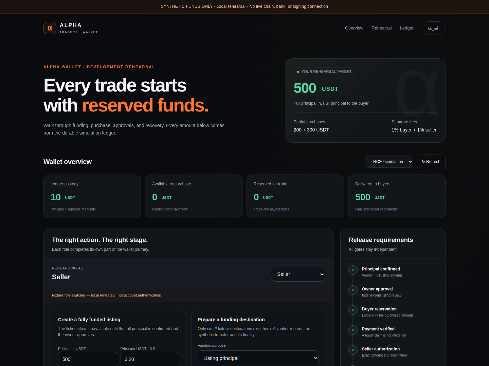

# Alpha Wallet: access, recovery and browser verification

Date: 4 November 2026. Scope: **isolated development with synthetic funds**.

The complete verification pipeline passed for commit [`23ee55fa4de00e325bd78a82b5e5ed423281e70c`](https://github.com/alphakits/alpha-traders-exchange/commit/23ee55fa4de00e325bd78a82b5e5ed423281e70c), tree `e0aab06bdeb7974c646aaa329125e085d9bbd6e5`, on `feature/alpha-wallet-dev-20261104`. This does not authorize or establish readiness for a live launch. Later authentication/platform integration changes require their own verification.

## Executed checks

| Check | Observed result |
| --- | --- |
| Local complete wallet suite | **468 passed, 0 failed, 0 pending, across 16 files** |
| CI complete wallet suite | **468 passed, 0 failed, 0 pending, across the same 16 files** |
| Full-project TypeScript | Passed locally and in CI with `--noEmit --incremental false` |
| Offline principal/commission demonstration | 500 principal funded and delivered as 200 + 300; 10 separately funded commission recognized; no remaining customer principal |
| Native PostgreSQL contention | Six checks passed using two independent Node processes and disposable PostgreSQL 17.11 |
| Native backup/paused restore | Six checks passed using separate fresh source/target databases |
| Actual browser journey | Passed in Chromium 149.0.7827.55: English desktop at 1440 px and Arabic RTL at 390 px |
| Browser response-loss recovery | Reservation and withdrawal committed before an intentionally truncated response; exact original request recovered after reload without another allocation |
| Browser errors and overflow | Zero page/console errors; horizontal overflow assertions passed for captured views |
| Rendered screenshots | Root assistant inspected desktop final/recovery and Arabic mobile final/full-page captures; no visible overlap or horizontal clipping found |

The [successful CI run](https://github.com/alphakits/alpha-traders-exchange/actions/runs/41911360316) completed by **21:01:19 UTC / 23:01:19 Jerusalem time**. Job `126859454460` ran the locked dependencies under Node 24.22.1. The local Chromium download returned a truncated archive; the browser result above comes from the actual successful CI run, not a local browser claim.

## Important behaviors verified

### Response loss preserves one original operation

The rehearsal persists the original request path, body, request ID, fixture role and durable rehearsal ID before sending. If the response becomes uncertain, unrelated mutations and role changes remain held. Reloading or restarting the same wallet directory retains the request. A later rejection before application cannot erase uncertainty from an earlier attempt.

The actual Chromium check first let the loopback server commit, then replaced only the delivered response body with truncated JSON. On reload, the page sent the same request and rehearsal identity. The reservation remained at revision 7 on recovery. The withdrawal remained at revision 6 with exactly one 25-USDT hold, 75 available from a 100-USDT deposit, and zero provider submissions. These are injected response failures after real development commits, not a claim about every possible network failure.

Separate executed page-JavaScript tests reopened the same directory with its role reset, and replaced the server at the same origin with a different funded wallet. The original request recovered only for its original wallet. A mismatched persisted wallet identity was refused by both page and server before a role change or financial mutation. Invalid amounts and unavailable browser storage sent no mutation. Malformed retained records stayed held for inspection.

### Recovery keeps uncertain money reserved

The native concurrency fixture proved once-only deposit credit, contention-safe inventory reservation, a single dispatch claim, once-only finalized debit/commission creation, reconciliation of an injected lost commit acknowledgement by original identity, and identical reconstruction after a new connection. Its final principal was 300 delivered plus 200 reserved from an original 500; 6 commission due remained separate.

The native backup fixture exported and independently replayed the source history. A corrupted checkpoint with a recomputed checksum was rejected before a target transaction opened. A real division-by-zero SQL failure at the final pause rolled back the entire restore, including schema creation.

The successful restore retained every original command row, hash and timestamp, then appended exactly one pause command in the same transaction. A new connection recovered 500 custody as 300 available plus 200 held for the uncertain payout. Replaying its original dispatch claim returned `shouldDispatch: false`. The recovery worker looked up the original provider reference once and submitted nothing. A new dispatch command stayed blocked by the pause.

The local backup suite also simulated a successful restore commit followed by a lost acknowledgement. Reopening the same target found the already restored paused history; a replacement restore and new dispatch were refused. The CLI now tells an operator to retain and inspect that exact directory rather than assume rollback. This lost acknowledgement is an injected fault, not an actual network partition.

### Access and chain evidence remain bounded

The trusted-resolver gateway tests cover canonical roles, account verification, ownership, private projections, session expiry and rereads, exact withdrawal-proof terms, and failures after a committed mutation. A committed action whose private response becomes unavailable is reported as committed, without leaking the private view or suggesting rollback.

The pure chain-evidence tests validate exact supplied BSC/TRON receipt context, execution status, event identity, token/recipient/raw amount and supplied canonical ancestry. Their output explicitly carries `creditAuthority: false`. These tests do not authenticate a node, establish real chain finality, assign deposit addresses or authorize credit by themselves.

## Browser evidence

These images are unedited captures of the actual running loopback rehearsal. The role selector is a fixture control, not account authentication.

- [English desktop overview](previews/english-desktop-final-viewport.png)
- [English funded reservations](previews/english-desktop-funded-reservations.png)
- [English uncertain payout and original-reference recovery](previews/english-desktop-unknown-submission.png)
- [Arabic mobile overview](previews/arabic-mobile-final-viewport.png)
- [Arabic partial settlement](previews/arabic-mobile-partial-settlement.png)
- [Arabic full settlement](previews/arabic-mobile-full-settlement.png)



The full browser flow independently funded 500 principal, required owner approval, reserved 200 and 300, recorded buyer claims, required verifier evidence and seller authorization, recovered an unknown provider response, and settled both payouts. The final view showed **500 delivered, 0 reserved, 0 commission due, and 10 custody/revenue from the separate commission deposit**. The provider-finality step alone did not settle the ledger; the matching ledger confirmation was still required.

## Reproducibility and retained evidence

[Machine-readable results](phase3-verification-results.json) retain the local and CI test names/statuses, exact tested commit/tree, source SHA-256 values, native fixture outputs, browser observations, screenshot hashes, CI steps and artifact metadata.

CI artifact `13362453207` is `alpha-wallet-simulation-evidence-23ee55fa4de00e325bd78a82b5e5ed423281e70c`, 1,970,780 bytes. The downloaded ZIP was verified against GitHub's digest:

```text
sha256:1c61d03661bd0c804bc5153da8abc028b3f97c7c47cfed1b45d8d0c2c70dc45a
```

The uploaded artifact expires on 18 November 2026; the report and selected rendered evidence are retained in the development branch. Reproduction commands are recorded in `.github/workflows/alpha-wallet-development.yml`, [recovery-runbook.md](recovery-runbook.md) and [rehearsal.md](rehearsal.md). They use explicit fixture databases and local synthetic providers, with no production environment URL lookup.

## What this milestone does not establish

All accounts, addresses, chain evidence, provider transfers and fiat verification in the rehearsal are synthetic. The tested commit contains no actual platform session adapter or wallet route. Follow-on authentication work, marketplace consent/reservation/completion consistency, buyer eligibility, notifications, receipts, ranks, benefits and an idempotent integration outbox remain separate work.

Custody/signing selection, real asset/address configuration, authenticated chain observers, bank/cash evidence authority, operational reconciliation, controlled incident resume and a reviewed production rollout remain incomplete. A logical backup checksum does not prove authenticity or freshness. Whole-wallet serialization and full history replay are still a correctness bridge, not a production load/availability design. This agent review is not an independent professional security audit or complete accessibility/product acceptance.

No main merge, production migration, live deployment, real key creation, signing or transfer was performed. The user's no-live instruction remains in force. Current release gates are tracked in [launch-readiness.md](launch-readiness.md).
